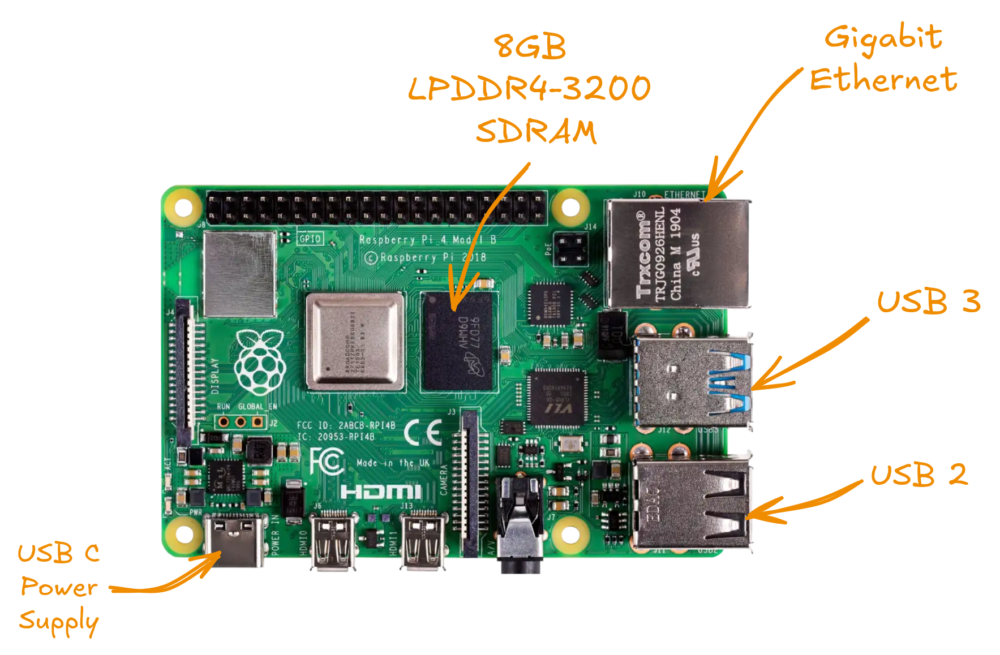
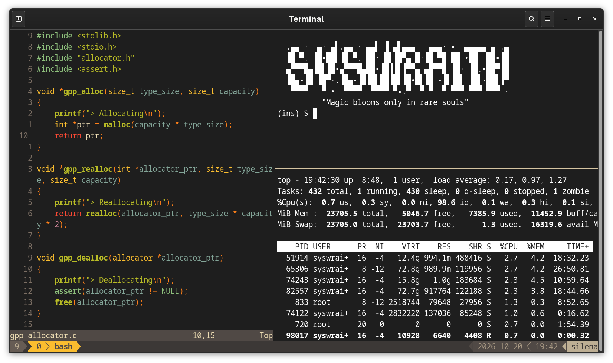
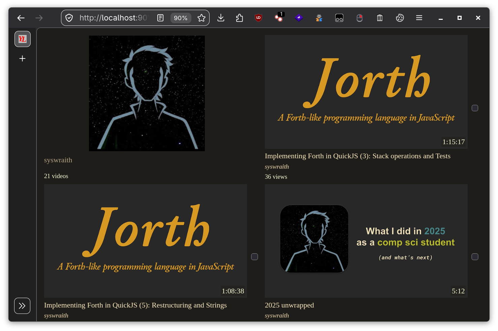
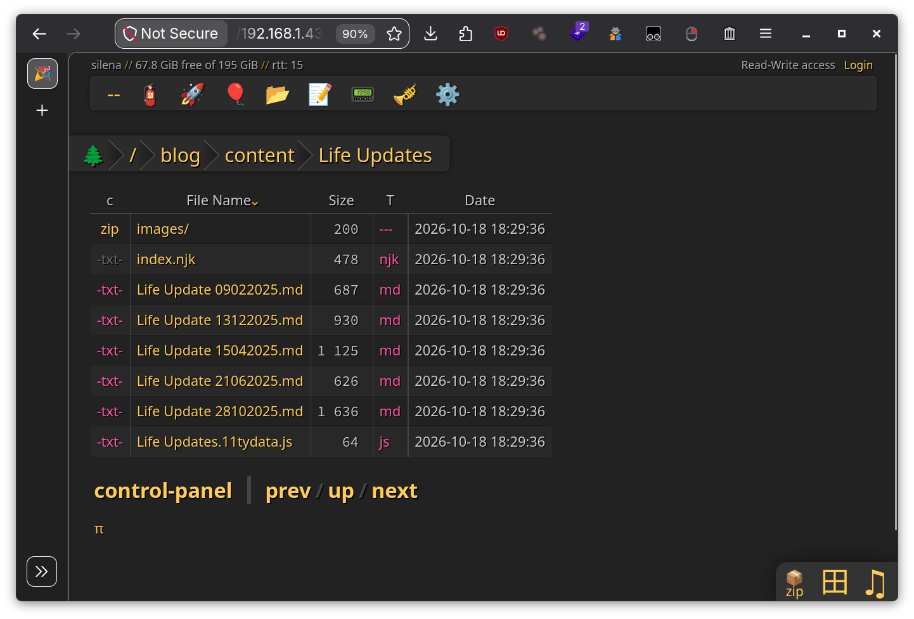
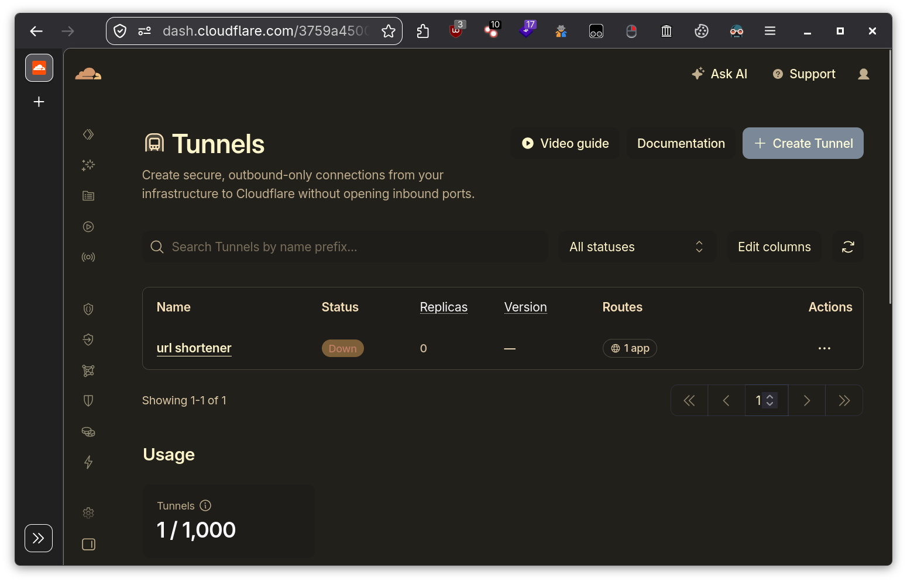
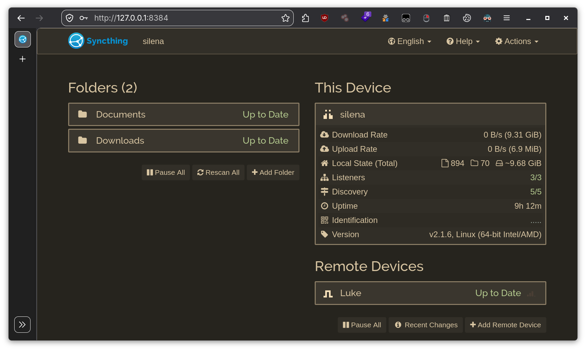

\

I've been trying to build a proper homelab for a long, long time.

<tweet-card id="1950433995701031361"></tweet-card>

That was almost a year ago, and while it "worked" back then, it never really stuck. Fast forward to today, and I finally decided to do it properly. This post documents the whole journey: what I bought, what I ran, and where it's all going.

---

# Hardware

## Raspberry Pi 4B

Bought this back in 2022, and for the longest time it was gathering dust in my drawer. About time I finally put it to good use. This will be the main machine hosting most of the stuff I'm mentioning here. I've plugged it directly into my router to ensure maximum internet speed.

## Other

- **Seagate ST1000LM024**: 1TB Laptop HDD (SATA), holds the Jellyfin media library
- **Ethernet Data Cable**: CAT.5 UTP 26WG PVE 75°C
- **SanDisk Ultra 32GB microSDHC**: UHS-I, Class 10 memory card, A1 performance rating

---

# Software

## OS

- **[Ubuntu Server](https://ubuntu.com/download/raspberry-pi)**: Official Ubuntu LTS for Raspberry Pi: 5 years free security updates, 64-bit ARM optimized, headless server OS. I considered using [DietPi](https://www.dietpi.com/), [Arch](https://archlinux.org/), [Raspberry Pi OS](https://www.raspberrypi.com/software/), but this comes with most of the stuff configured out of the box, and is simple enough to manage.

## Apps

- **[Serverbox](https://github.com/lollipopkit/flutter_server_box)**: A fantastic Android app to monitor remote servers. Keeps an eye on Chiron, Silena, Luke, and my [tilde club](https://ctrl-c.club) server.

- **[My dotfiles](https://github.com/syswraith/dots)**: Custom configurations for [bash](https://www.gnu.org/software/bash/), [kitty](https://sw.kovidgoyal.net/kitty/), [neovim](https://neovim.io/), [yazi](https://yazi-rs.github.io/), [tmux](https://github.com/tmux/tmux), [git](https://git-scm.com/). Just clone the repository and use [`stow . --adopt`](https://www.gnu.org/software/stow/) to apply it.

- **[yt-local](https://git.sr.ht/~heckyel/yt-local)**: Fast, minimalistic, privacy-focused, self-hosted YouTube client. SponsorBlock integration, local playlists, etc. Handy if you're dopamine detoxing.

- **[copyparty](https://github.com/9001/copyparty)**: Portable file server, running bare metal rather than Docker. Resumable uploads/downloads via HTTP/WebDAV/SFTP/FTP, single-file Python app, media indexer, thumbnails, deduplication. Honestly, this is a goldmine.

## [Tailscale](https://tailscale.com/)

Tailscale is the backbone of this entire homelab. Without it, I'd be stuck port-forwarding everything on my router and exposing services I really don't want to. And even then, most Indian ISPs operate on [CGNAT](https://www.cloudproxy.in/blog/2026-09-27-cgnat-jio-airtel-port-forwarding/), which means port forwarding isn't even an option to begin with.

It's a mesh VPN built on [WireGuard](https://www.wireguard.com/) that just works. If you want to dig deeper, the [how Tailscale works](https://tailscale.com/blog/how-tailscale-works) blog post does a great job of breaking down the architecture, and the [MagicDNS](https://tailscale.com/kb/1193/magicdns) docs cover how every device gets a human-readable hostname on the tailnet. Setup is dead simple: install the client, log in, done.

I like naming my devices, so:

- **Chiron**: Raspberry Pi
- **Silena**: Laptop
- **Luke**: Phone

At its core, Tailscale puts all of these on the same subnet, even though they're on completely different networks.

## [Cloudflare Tunnels](https://www.cloudflare.com/products/tunnel/)

Like Tailscale, Cloudflare Tunnels doesn't care about CGNAT. The `cloudflared` daemon on Chiron makes outbound connections to Cloudflare's edge, so there's nothing to port-forward on either end.

I initially had my [Jellyfin](https://jellyfin.org/) server exposed through the tunnel so I could stream from outside home. Turns out that's against their [community standards](https://jellyfin.org/docs/general/community-standards/), so I pulled it down.

Now I'm just hosting a simple, private URL shortener that powers *https://u.syswraith.com*.

I manage the whole thing through the Cloudflare dashboard rather than copy-pasting configs around. It's more intuitive that way: click, add a public hostname, pick a service, done.

## [Syncthing](https://syncthing.net/)

Continuous file sync between my devices, hosted by me. I didn't want to rely on nonfree cloud services for this, and Syncthing does exactly what I need without asking for an account. If you want a good overview, Mental Outlaw made a solid video on it:

<iframe class="youtube-embed" src="https://www.youtube.com/embed/Uag8PJaO0N4" title="Syncthing - The Based Way to Sync Your Files" loading="lazy" allowfullscreen></iframe>

Right now it just keeps two folders in sync between Silena and Luke:

`silena:///home/syswraith/Downloads <-> luke:///storage/emulated/0/Download`

`silena:///home/syswraith/Documents <-> luke:///storage/emulated/0/Documents`

Chiron isn't part of this. The Pi is always on and hosting services, but my personal files don't need to live there.

On Android, the official app is unmaintained, so I'm using [Syncthing-Fork](https://github.com/Catfriend1/syncthing-android) instead. And since both devices are on my tailnet, Syncthing just works directly over the Tailscale network, no extra port forwarding, no discovery headaches.

## [Docker](https://www.docker.com/)

Most of what runs on Chiron is containerized. I wanted everything isolated so it wouldn't mess with the core system, and Docker Compose made that straightforward: define a stack in a YAML file, run one command, done.

I went with [YAMS - Yet Another Media Server](https://yams.media/) for the media stack. It was easy to set up and covers almost all of my use cases. The way it works:

- [qBittorrent](https://www.qbittorrent.org/): Torrent downloader, saves everything straight to the Seagate HDD
- [Radarr](https://radarr.video/): Movie collection manager
- [Sonarr](https://sonarr.tv/): TV series collection manager
- [Prowlarr](https://prowlarr.com/): Indexer manager, feeds indexers to Radarr and Sonarr
- [Bazarr](https://www.bazarr.media/): Subtitle downloader
- [Jellyfin](https://jellyfin.org/): Media streaming server

The flow: Prowlarr manages the indexers, Radarr and Sonarr tell qBittorrent what to grab, Bazarr fills in the subtitles, and Jellyfin streams the final result.

To keep an eye on all of this, [Portainer](https://www.portainer.io/) gives me a web UI to view and manage every container running on Chiron.

Oh, and the URL shortener powering *https://u.syswraith.com* is also a Docker container.

---

# What's left?

- Proper cooling would be nice. Right now I'm using a Pimoroni Fan SHIM, a compact, solderless cooling fan that's mounted on the GPIO pins. It's sufficient for the Raspberry Pi but not for the Seagate HDD.
- A proper UPS to ensure power outages don't hit Chiron directly.
- A nice speaker ~~so I can freak out my parents when I'm in college~~ for playing music.

Got a homelab of your own? Suggestions? Drop them somewhere I can find them. Now if you'll excuse me, Sonarr has a new season to download.
